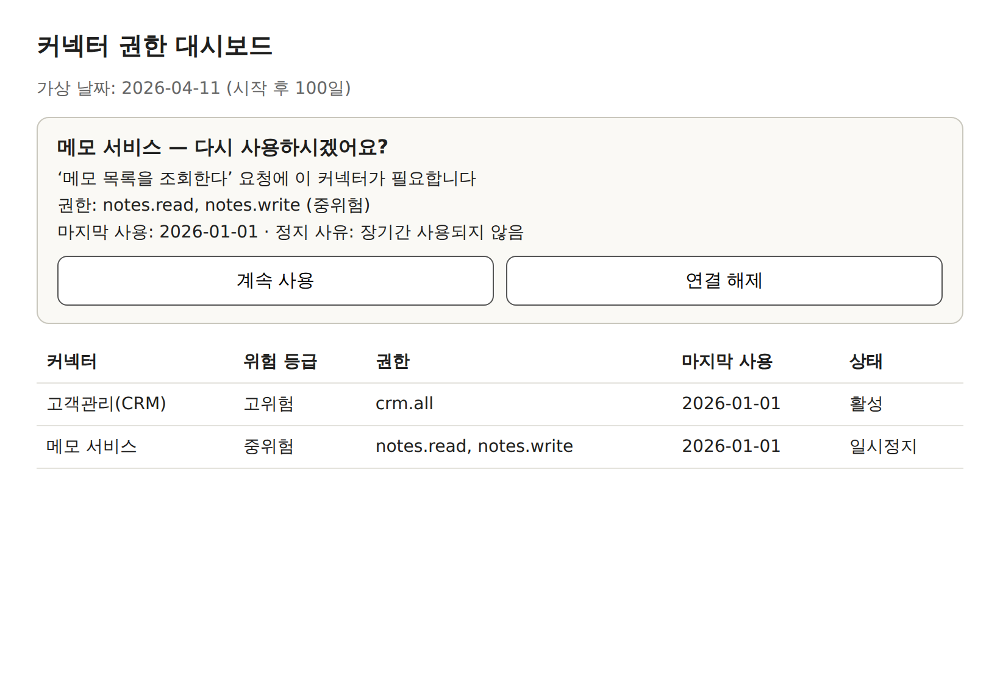

# Connector Guard — 방치된 AI 에이전트 커넥터 권한 관리 개념 증명(PoC)

「2026 정보보호 정책제안 공모전」 정책제안서 **「AI 에이전트 커넥터의 방치된 접근권한 관리 기준 도입」**의 3.5절 프로토타입입니다.

이 프로토타입은 AI 에이전트와 MCP 서버 사이에 **감시 프록시** 하나를 추가하는 것만으로 제안서의 기준을 구현할 수 있음을 보여 줍니다. 제안서의 기준은 다음과 같습니다.

- 도구 호출 이력에 기반한 미사용 판정
- 위험 등급별 기간과 12개월 절대 상한
- 이용자 본인만 할 수 있는 재확인
- 해제 시 연쇄 폐기

## 바로 실행하기

외부 패키지와 인터넷 연결이 필요 없습니다(Python 3.10 이상, 표준 라이브러리만 사용).

```bash
python demo.py                 # 제안서 [표 3-5]의 6개 장면을 순서대로 재현 (몇 초)
python demo.py --interactive   # 장면 3에서 멈춤 → 브라우저로 http://127.0.0.1:8765/ 를 열어 직접 [계속 사용] 클릭
python demo.py --keep          # 시연이 끝난 뒤 재확인 화면을 띄워 둔 채로 유지 (종료: Ctrl+C)
python -m unittest -v          # 장면별 자동 검증 (12개 테스트)
```

재확인 화면 주소는 기본적으로 `http://127.0.0.1:8765/`이며, 8765 포트가 사용 중이면 다른 포트를 골라 실행 첫 줄에 표시합니다.

가상 시계로 약 1년 반(545일)을 몇 초로 줄여 시연합니다. 전체 출력 예시는 [`docs/demo_output.txt`](docs/demo_output.txt)에 있습니다.

## GitHub 연동 시연 (선택)

가상 발급기관 대신 **실제 GitHub**와 연동해, 마지막에 GitHub 토큰이 실제로 폐기되는 것까지 보여 줍니다.

**1. GitHub OAuth App 만들기 (처음 한 번)**
1. GitHub → Settings → Developer settings → OAuth Apps → **New OAuth App**
2. Application name: 아무 이름(예: `connector-guard-poc`), Homepage URL과 Authorization callback URL: `http://127.0.0.1`
3. **Enable Device Flow**에 체크하고 등록
4. Client ID를 복사하고, **Generate a new client secret**으로 비밀값을 만들어 복사
5. `.env.example`을 복사해 `.env`로 저장하고 두 값을 채움 (`.env`는 저장소에 올라가지 않음)

**2. 로그인 → 시연**
```bash
python github_login.py              # 화면에 나온 코드를 github.com/login/device 에 입력하고 승인 (권한: read:user)
python demo_github.py               # 자동 시연
python demo_github.py --interactive # 재확인 카드를 브라우저에서 직접 누르기
```

- 요청 권한은 최소 권한인 `read:user`(프로필 읽기)이며 위험 등급은 **저위험(180일)**입니다.
- 마지막 장면에서 GitHub 토큰 폐기 API(`DELETE /applications/{client_id}/token`)를 실제로 호출하고, 토큰 확인 API로 **무효(404)**가 된 것을 확인합니다.
- 토큰이 실제로 폐기되므로, 다시 시연하려면 `github_login.py`부터 다시 실행합니다.
- 자동 테스트(`tests/test_github.py`)는 실제 GitHub 대신 같은 API 형식의 가짜 서버로 이 흐름을 검증합니다.

## 구조

```
[데모 에이전트] ─①─▶ [감시 프록시] ─②─▶ [MCP 서버] ─③─▶ [가상 발급기관]
                         │     ◀─④──  (토큰 보관)  ─⑦─▶ (RFC 7009 폐기 / RFC 7662 조회)
                        ⑤│▲⑥
                     [재확인 화면]  ← 이용자 본인만 조작
```

| 구성요소 | 파일 | 실제 세계의 역할 |
|---|---|---|
| 데모 에이전트 | `demo.py` | ChatGPT·Claude 같은 AI 에이전트. 호출마다 출처(`_meta.callSource`)를 표시 |
| **감시 프록시** | `guard/proxy.py` | 플랫폼이나 중계 사업자가 내부에 갖출 기능. 모든 `tools/call`이 이곳을 지남 |
| MCP 서버 | `guard/resource_server.py` | 외부 서비스 토큰을 **직접 보관**하는 커넥터(예: 노션 MCP 서버) |
| 가상 발급기관 | `guard/issuer.py` | 노션·구글 같은 외부 서비스. 토큰 발급, 데이터 API, 폐기·조회 |
| 재확인 화면 | `guard/ui.py` | 플랫폼이 이용자에게 보여 주는 재확인 카드·대시보드 |
| GitHub 커넥터(선택) | `guard/github_server.py`, `guard/github.py` | 실제 GitHub 토큰을 보관·사용·폐기하는 MCP 서버 |
| 기준값 | `guard/policy.py` | 위험 등급표([표 3-2])와 기간([표 3-3]) |
| 저장소 | `guard/store.py` | 자격증명 상태와 커넥터 구성을 분리해 저장, 가상 시계 |

MCP 통신은 MCP 규격의 stdio 전송(줄 단위 JSON-RPC 2.0: `initialize`, `tools/list`, `tools/call`)을 표준 라이브러리로 직접 구현했습니다.

## 시연 장면 ([표 3-5])

| 순서 | 장면 | 확인 방법 |
|---|---|---|
| 1 | 커넥터 등록 → 위험 등급 산정. 분류표에 없는 권한(`crm.all`)은 **고위험** | `test_1` |
| 2 | Day 60 사전 고지 1회 → Day 90 일시정지. **구성 정보는 보존** | `test_2` |
| 3 | 정지된 커넥터 요청 → 이용자 화면에 재확인 카드 → [계속 사용] → 원래 요청 재실행. 같은 재확인 값의 재사용은 거부 | `test_3` |
| 4 | 12개월 절대 상한으로 정지된 뒤, 예약 작업 호출은 **건너뛰고 알림 1회**, 에이전트 자율 호출은 **차단만(알림 없음)** | `test_4` |
| 5 | 에이전트가 재확인을 대신하려는 시도 3가지(도구 호출, 프로토콜 메서드, 화면 요청 위조) → 모두 거부되고 이력에 기록 | `test_5` |
| 6 | 무응답 지속 → Day 515 최종 고지 → Day 545 해제. 구성 정보 삭제 → MCP 서버에 폐기 통지 → 보관본 파기 → 발급기관 폐기 → **조회 결과 `active: false`** | `test_6` |



## 제안서 설계와의 대응

| 제안서 | 구현 |
|---|---|
| 활동 = 실제 도구 호출(3.2) | `Guard.call`: 이용자 요청과 등록된 예약 작업만 활동으로 계산. 토큰 갱신·에이전트 자율 호출·차단된 호출은 제외 |
| 예약 작업은 등록 주기 2회 초과 시 정지(3.2) | `policy.inactivity_threshold` |
| 위험 등급 차등, 판별 불가 시 고위험(3.3) | `policy.risk_of` |
| 12개월 절대 상한(3.2) | `Guard.tick`: 사용 여부와 관계없이 마지막 재확인 후 365일이 지나면 정지 |
| 재확인은 이용자 본인만(3.4, 고시안 ④) | 재확인은 도구로 노출하지 않음. 이용자 화면에서만 발급되는 1회용 값이 있어야 처리 |
| 단계별 알림 채널([표 3-4]) | 사전 고지(이메일·푸시), 재확인 카드(화면), 예약 작업 건너뜀(1회), 최종 고지(이메일) |
| 데이터 분리, 요청 내용 미저장(3.5) | `connectors.config`와 `cred_state` 분리. `calls` 테이블에 도구 인자를 저장하지 않음 |
| 연쇄 폐기, 참조 카운트, 재시도(3.5) | `Guard.release` → `x-guard/revoke` → `resource_server.revoke`(참조가 모두 사라질 때 폐기, 실패 시 재시도 후 직접 폐기 안내) |

## 이 프로토타입이 보여 주지 않는 것 (한계)

- **호출 출처의 정확성:** 데모 에이전트가 호출 출처를 스스로 표시한다고 가정합니다. 실제로는 플랫폼이 출처를 구분해 전달해야 합니다(제안서 5.2).
- **이용자 인증:** 재확인 화면은 `127.0.0.1`에서만 열리며 로그인 인증을 생략했습니다. 실제 서비스에서는 로그인한 이용자 본인의 화면이어야 합니다.
- **알림 발송:** 이메일·푸시는 실제로 보내지 않고 기록으로 대체했습니다.
- **발급기관:** 기본 시연의 외부 서비스는 가상 발급기관입니다(실제 GitHub 연동은 선택 기능). 토큰 발급 과정(이용자 동의 화면)은 간소화했습니다. 폐기·조회는 RFC 7009·7662 형식을 따르므로 실제 발급기관의 엔드포인트로 교체할 수 있습니다.
- **`x-guard/revoke`:** MCP 규격에는 폐기 통지 메서드가 없어서 프로토타입용 확장 메서드로 정의했습니다.

## 참고 표준

- IETF RFC 7009, OAuth 2.0 Token Revocation
- IETF RFC 7662, OAuth 2.0 Token Introspection
- IETF RFC 9700, Best Current Practice for OAuth 2.0 Security
- Model Context Protocol Specification
